# Consultor Avançado de Carreiras em TI

Sistema de orientação exploratória de carreiras desenvolvido em **Python**, com interface web em **Streamlit** e base de conhecimento externa em **JSON**. A aplicação avalia interesses técnicos, objetivos profissionais e atividades que a pessoa prefere evitar para apresentar um **ranking com as três carreiras de TI mais compatíveis (Top 3)**.

Depois de consultar o ranking, o usuário pode escolher uma das carreiras recomendadas, avaliar seu conhecimento técnico atual e receber uma **trilha personalizada de aprendizagem**, construída a partir das competências que ainda precisa desenvolver.

> **Importante:** os percentuais são **índices orientativos de compatibilidade calculados pelo modelo**, não probabilidades de contratação, diagnósticos de aptidão nem garantias de sucesso profissional. Os níveis de referência “Júnior” são parâmetros pedagógicos do protótipo, não requisitos universais do mercado.

## Funcionalidades

- **13 perguntas de afinidade técnica**, com escala de 1 a 5 e opção para indicar desconhecimento de uma área.
- **8 perguntas sobre objetivos profissionais**, também em escala de 1 a 5.
- **8 restrições opcionais**, para declarar atividades que a pessoa prefere evitar; uma restrição não elimina automaticamente uma carreira.
- **Verificação de possíveis contradições** entre afinidade alta e atividades que a pessoa declarou preferir evitar, com possibilidade de revisão ou confirmação.
- **Cálculo ponderado das compatibilidades**, com pesos por carreira cadastrados no JSON e descontos proporcionais às restrições.
- **Top 3 de carreiras**, com percentuais e explicações sobre afinidades, objetivos, cobertura das respostas e penalidades.
- **Avaliação de cinco competências técnicas** da carreira escolhida, em escala de 0 a 3, comparadas a referências Júnior da base.
- **Identificação de lacunas de conhecimento (*skill gaps*)** e geração de um roadmap com quatro etapas: fundamentos, desenvolvimento técnico, projeto para portfólio e consolidação.
- **Sugestões práticas**, pré-requisitos, entregáveis para GitHub e certificações opcionais, conforme o cadastro da carreira.
- **50 testes automatizados**, executados com `unittest`, para verificar o motor e a consistência da base.

## Demonstração da aplicação

As imagens a seguir são **capturas reais da versão atual da aplicação** em execução local. São cenários ilustrativos; as recomendações variam conforme as respostas. As barras do navegador foram retiradas para destacar a interface do sistema.

### 1. Tela inicial

Apresenta a finalidade da ferramenta e inicia o questionário.

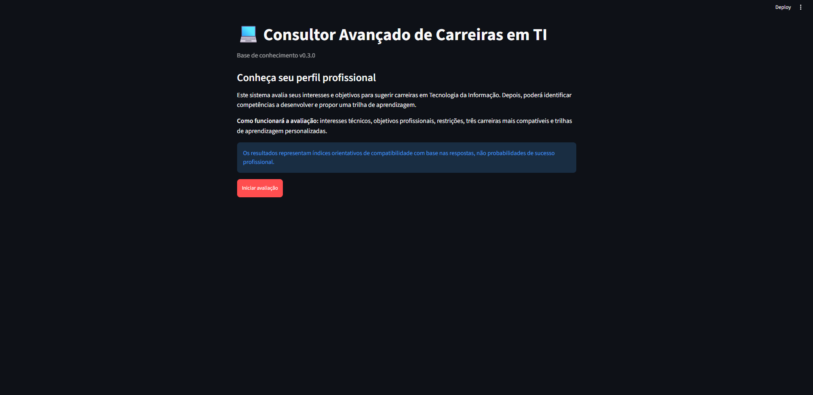

### 2. Perfil profissional

A coleta de informações é dividida em três etapas. As afinidades e os objetivos são avaliados individualmente, enquanto as restrições permitem seleção múltipla.

**Afinidades técnicas — 13 perguntas:**

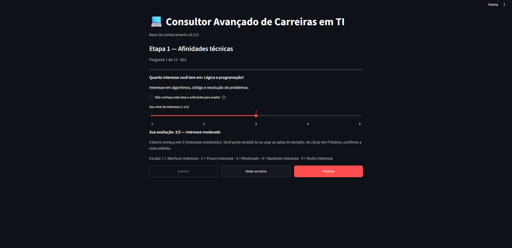

<details>
<summary><strong>Ver também: objetivos profissionais e restrições</strong></summary>

**Objetivos profissionais — 8 perguntas:**

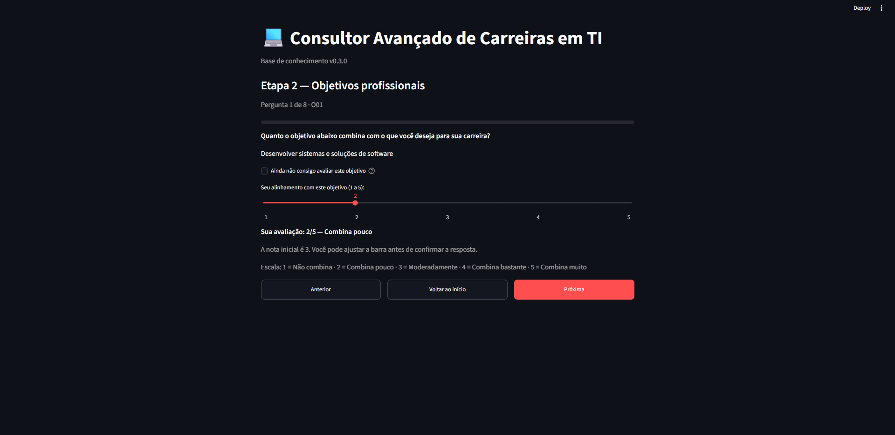

**Atividades que prefere evitar — 8 opções:**

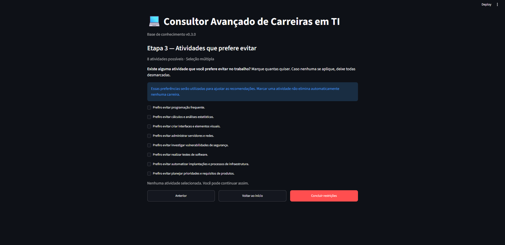

</details>

**Perfil registrado:** ao finalizar as respostas, a aplicação apresenta um resumo e permite revisar cada grupo antes de calcular o ranking.

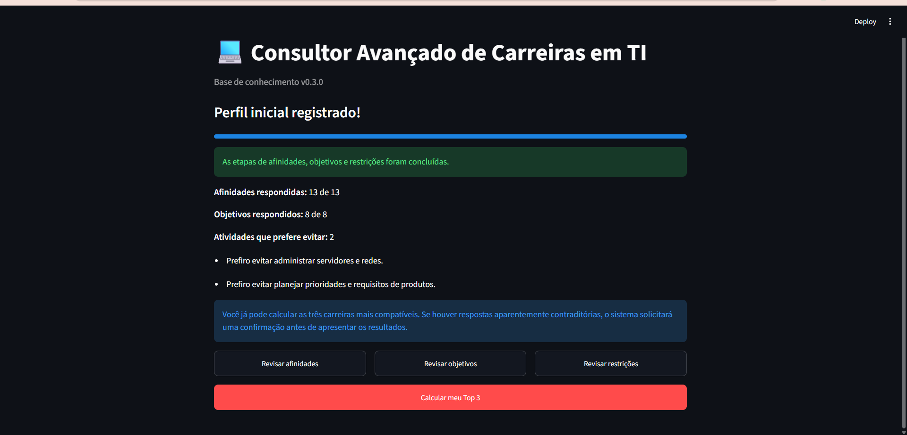

### 3. Recomendação das três carreiras mais compatíveis

O sistema apresenta as três carreiras classificadas, seus índices de compatibilidade e uma explicação acessível para os resultados. A imagem mostra **um exemplo de execução**, e não uma recomendação fixa do projeto.

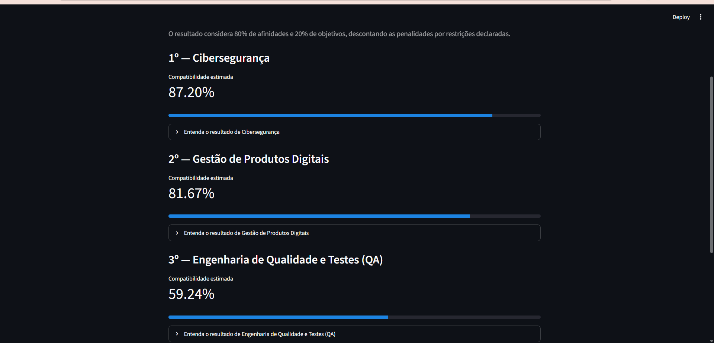

O detalhamento mostra os componentes usados no cálculo, as afinidades e objetivos com maior contribuição e eventuais penalidades.

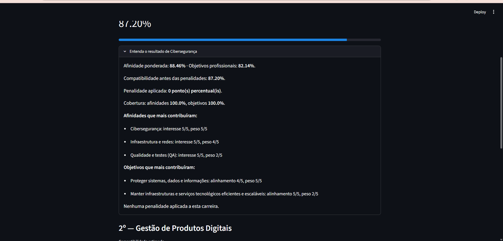

### 4. Avaliação de competências

A pessoa escolhe uma das carreiras do Top 3 e informa seu nível atual em **cinco competências específicas**. A escala vai de **0 (nenhum conhecimento)** a **3 (conhecimento prático)**, com opção de resposta desconhecida. Essa avaliação **não modifica a classificação do Top 3**.

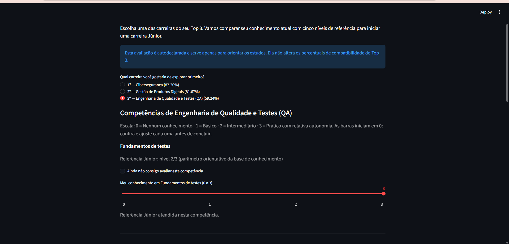

### 5. Lacunas e trilha de aprendizagem personalizada

O sistema compara o nível autodeclarado com os níveis de referência Júnior. No exemplo, **Testes de API** é a única competência abaixo do parâmetro da base, portanto é priorizada na trilha.

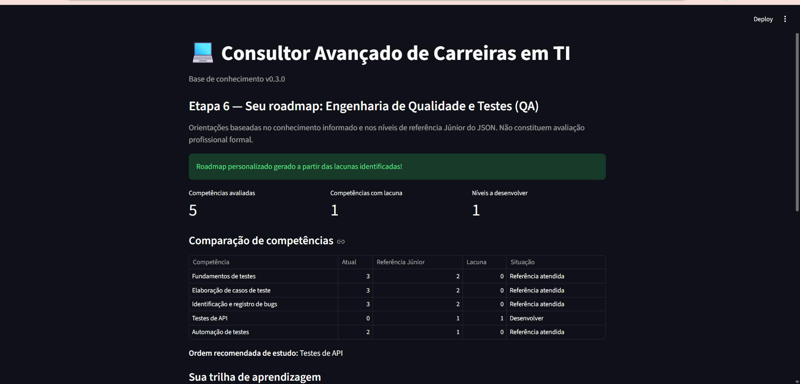

A trilha é organizada em quatro partes:

1. **Fundamentos:** conteúdos de base e pré-requisitos das competências com lacuna.
2. **Desenvolvimento técnico:** práticas e tecnologias para aprofundar os conhecimentos necessários.
3. **Projeto para portfólio:** aplicação integradora com entregáveis e evidências de aprendizagem.
4. **Consolidação e próximos passos:** revisão, documentação dos resultados e certificações opcionais.

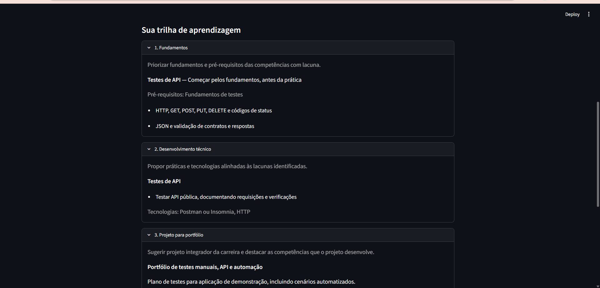

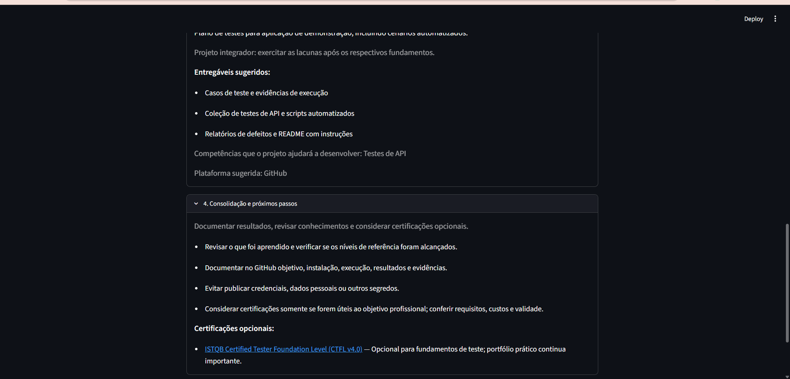

## Carreiras contempladas

1. Desenvolvimento Back-end
2. Desenvolvimento Front-end e UI/UX
3. Ciência de Dados e Machine Learning
4. Engenharia de Dados
5. Cibersegurança
6. DevOps e SRE
7. Computação em Nuvem
8. Desenvolvimento Mobile
9. Engenharia de Qualidade e Testes (QA)
10. Gestão de Produtos Digitais

## Como funciona o motor de inferência

O sistema utiliza **regras e pesos explícitos**, não um modelo de aprendizado de máquina treinado com dados de candidatos. A base `regras_carreiras.json` contém as dimensões, pesos, restrições, penalidades, competências e conteúdos de aprendizagem; o arquivo `motor_ponderado.py` executa os cálculos.

**1. Afinidades e objetivos.** As notas de 1 a 5 são normalizadas para a escala de 0 a 100 e combinadas em médias ponderadas específicas para cada carreira.

**2. Cobertura das respostas.** Respostas “não consigo avaliar” não são tratadas como nota mínima. Para uma carreira receber um percentual definitivo, é preciso alcançar **pelo menos 70% de cobertura ponderada nas afinidades e 70% nos objetivos**, separadamente.

**3. Compatibilidade inicial.** O modelo combina **80% de afinidades técnicas e 20% de objetivos profissionais**:

```text
Compatibilidade inicial = 0,80 × Afinidade ponderada + 0,20 × Objetivos ponderados
```

**4. Penalidades por restrições.** Uma restrição selecionada gera desconto de **8 pontos percentuais** quando corresponde a atividade principal da carreira, ou **4 pontos percentuais** quando corresponde a atividade complementar. A soma é limitada a **16 pontos percentuais por carreira**; nenhuma carreira é automaticamente excluída.

```text
Compatibilidade final = limitar(Compatibilidade inicial − Penalidades, 0, 100)
```

**5. Explicações e ranking.** O motor classifica as carreiras elegíveis e apresenta o Top 3 com detalhamento dos componentes e das restrições aplicadas. Possíveis contradições são submetidas à confirmação do usuário antes de mostrar o resultado.

**6. Lacunas técnicas.** Após a escolha de uma carreira, cada uma das cinco competências é comparada com sua referência:

```text
Lacuna = máximo(0, Nível de referência Júnior − Nível atual)
```

O roadmap prioriza lacunas identificadas e seus pré-requisitos. Competências não avaliadas não são tratadas como nível zero; nesse caso, a avaliação precisa ser completada antes de gerar o roadmap definitivo.

> Para a descrição integral das regras, pesos, critérios de desempate, verificações de contradição, competências e exemplos de cálculo, consulte a **[Matriz de Decisão e Engenharia do Conhecimento](../Downloads/matriz_decisao.md)**.

## Tecnologias utilizadas

- **Python 3.12.3** — linguagem utilizada no desenvolvimento.
- **Streamlit 1.66.0** — interface web interativa.
- **JSON** — base de conhecimento externa e configurável.
- **`unittest`** — testes automatizados, disponível na biblioteca padrão do Python.
- **Git e GitHub** — versionamento do projeto.

O projeto **não utiliza Experta nem frozendict** na versão atual; o mecanismo de inferência ponderada está implementado em Python.

## Instalação e execução

Exemplo para **Windows PowerShell**, com Python 3.12 e Git instalados. Se o repositório for privado, é preciso ter permissão para acessá-lo.

**1. Clonar o repositório:**

```powershell
git clone https://github.com/anabmaia76/consultor-carreiras-ti-etapa-2.git
cd consultor-carreiras-ti-etapa-2
```

**2. Criar o ambiente virtual:**

```powershell
py -3.12 -m venv .venv
```

**3. Instalar as dependências:**

```powershell
.\.venv\Scripts\python.exe -m pip install -r requirements.txt
```

**4. Iniciar a aplicação:**

```powershell
.\.venv\Scripts\python.exe -m streamlit run app.py
```

Abra o endereço mostrado no terminal, geralmente **http://localhost:8501**. Para encerrar o servidor, pressione **Ctrl + C** no terminal.

## Estrutura do projeto

```text
consultor-carreiras-ti-etapa-2/
├── .gitignore
├── app.py                   # Interface e navegação em Streamlit
├── motor_ponderado.py       # Cálculo ponderado, Top 3, lacunas e roadmap
├── regras_carreiras.json    # Base de conhecimento versão 0.3.0
├── matriz_decisao.md        # Regras de decisão e documentação técnica
├── teste.py                 # Suíte com 50 testes automatizados
├── requirements.txt         # Dependências necessárias
├── imagens/                 # Capturas reais da versão atual
│   ├── tela_inicial.png
│   ├── afinidades_tecnicas.png
│   ├── objetivos_profissionais.png
│   ├── restricoes_atividades.png
│   ├── perfil_registrado.png
│   ├── ranking_top3.png
│   ├── detalhamento_resultado.png
│   ├── avaliacao_competencias.png
│   ├── comparacao_lacunas.png
│   ├── roadmap_fundamentos_e_portfolio.png
│   └── roadmap_consolidacao.png
└── README.md                # Apresentação e instruções do projeto
```

A pasta `.venv/` é criada localmente e não deve ser versionada.

## Testes automatizados

Na pasta principal do projeto, com o ambiente virtual criado e as dependências instaladas, execute:

```powershell
.\.venv\Scripts\python.exe teste.py
```

Na verificação final realizada durante o desenvolvimento, **os 50 testes foram aprovados**. A suíte aborda carregamento e validação do JSON, entradas inválidas, médias ponderadas, cobertura mínima, penalidades, contradições, Top 3, lacunas e geração de roadmaps. Também foram realizadas conferências manuais da navegação e apresentação das telas no Streamlit.

A aprovação dos testes comprova os comportamentos cobertos pela suíte; **não equivale à validação estatística das recomendações para diferentes populações**.

## Limitações

- As recomendações dependem das respostas autodeclaradas e dos pesos definidos no protótipo.
- Os percentuais são índices internos de compatibilidade; não medem empregabilidade nem substituem orientação profissional individualizada.
- As referências Júnior são parâmetros de aprendizagem, e não exigências obrigatórias de todas as empresas.
- Cursos, tecnologias e certificações podem mudar; consulte as fontes oficiais antes de escolher uma formação.

## Contexto acadêmico

Projeto desenvolvido para a disciplina de **Inteligência Artificial**, do curso de **Ciência da Computação**, no **Centro Universitário Presidente Antônio Carlos (UNIPAC), Barbacena (MG)**.

A aplicação foi concebida para apoiar a exploração de interesses de carreira e demonstrar a aplicação de uma **base de conhecimento explícita, regras de inferência, cálculos ponderados e explicabilidade** em um sistema de orientação profissional.
